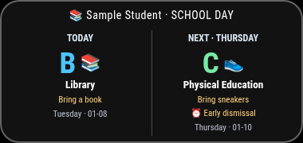

# MMM-SchoolDayRotation

Rotating school letter days, activities, reminders and next-school-day cards.

Version 0.1.0. MIT-licensed standalone MagicMirror module.



## Installation

From your MagicMirror installation directory:

```sh
cd modules
git clone https://github.com/QuietNodeLab/MMM-SchoolDayRotation.git
```

Alternatively, download the repository ZIP and extract it as the folder below.

Copy this folder into `MagicMirror/modules/MMM-SchoolDayRotation`. No extra npm
runtime packages or shared dashboard stylesheet are required. Use MagicMirror
2.38.0 with Node 24 as the tested baseline; other versions still need
verification.

Copy `school-day.example.json` to `MagicMirror/config/school-day.json`. Keep
real data private and outside Git.

Add a module entry to your local config:

```js
{
  module: "MMM-SchoolDayRotation",
  position: "top_left",
  config: {
    "dataFile": "school-day.json",
    "studentName": "Sample Student",
    "team": "sample",
    "timezone": "Europe/London"
  }
}
```

## Behavior and configuration

Use `letters`, `anchors`, `teams`, `reminders`, `closed`, `earlyDismissal` and
`overrides` as shown in the synthetic example. An anchor assigns a configured
letter to one date. Weekends and closures do not advance the rotation; an
override changes only that date. Team activities are arrays indexed by letter.
Keep at least one valid school-day anchor and maintain closures for your school
year.

Options: `dataFile` (school-day.json), `studentName` (Sample Student), `team`
(null = JSON team), `timezone` (null = browser zone), `refreshInterval` (600000
ms), `showNext` (true), `eveningHour` (18; null disables emphasis), `debugDate`
(null). The card displays today and, optionally, the next school day. Evenings
emphasize the next panel rather than mislabeling it as today. English
activity-to-emoji matching is built in.

Set `debugDate: "2030-01-08"` to preview the example. No school portal or
external service is contacted.

## Synthetic data example

```json
{
  "letters": ["A", "B", "C"],
  "team": "sample",
  "anchors": [
    {
      "date": "2030-01-07",
      "letter": "A"
    }
  ],
  "teams": {
    "sample": {
      "A": ["Art"],
      "B": ["Library"],
      "C": ["Physical Education"]
    }
  },
  "reminders": {
    "Library": "Bring a book",
    "Physical Education": "Bring sneakers"
  },
  "closed": {
    "2030-01-09": "Sample closure"
  },
  "earlyDismissal": {
    "2030-01-10": "Early dismissal"
  },
  "overrides": {}
}
```

## Development

`npm ci --ignore-scripts` and `npm test` run offline with Node 24. External APIs
must be mocked. JSON date modules use calendar dates; the configured zone
selects "today". Private configuration and cache data are ignored. All example
people, locations and events are synthetic or public examples. Screenshots use
only mock data.

Styles are scoped to the module. Change its own card CSS in your local
custom.css if desired; do not copy a full dashboard theme. Keep filenames as
filenames rather than absolute deployment paths. JSON helpers search config
first, then the module. Timers stop when the module is suspended and restart
when it resumes.

See [VALIDATION.md](VALIDATION.md) for tests actually performed and their
limits.

## License and attribution

The custom package code is MIT-licensed under module contributors; see
[LICENSE](LICENSE). No source-project Git history, private configuration,
optional device services or upstream module implementation is bundled.
MagicMirror is a separate dependency. See [ATTRIBUTION.md](ATTRIBUTION.md) for
artwork and external data notes.
